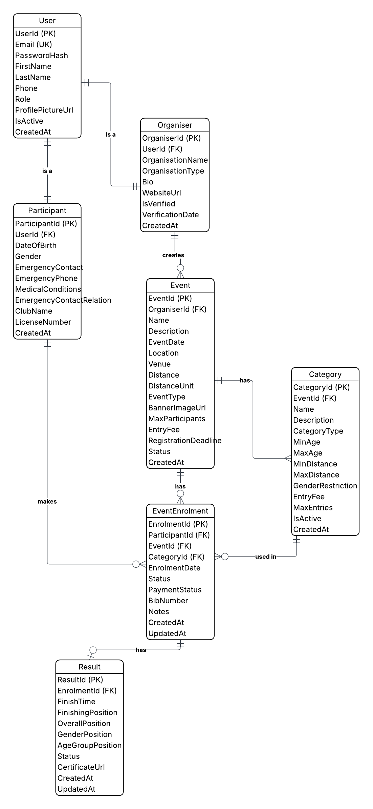
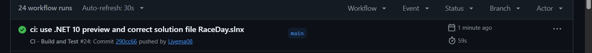

# 🏃 RaceDay - Event Management System
### PROG6212 - Programming 2B Portfolio of Evidence

[](https://github.com/Liyema08/PROG6212-POE-Part1/actions)

---

## 📋 Table of Contents
1. [Project Overview](#project-overview)
2. [User Roles](#user-roles)
3. [Database Design](#database-design)
4. [API Endpoint Plan](#api-endpoint-plan)
5. [Part 2 - RESTful API](#part-2---restful-api)
6. [Part 3 - MVC, Azure Blob & Docker](#part-3---mvc-azure-blob--docker)
7. [Getting Started](#getting-started)
8. [CI/CD Pipeline](#cicd-pipeline)
9. [Video Presentation](#video-presentation)
10. [Student Information](#student-information)

---

## 🎯 Project Overview

**RaceDay** is a comprehensive event management platform designed specifically for the South African road running, walking, and cycling community.

### Key Features
- **Role-based access** for Organisers and Participants
- **Event management** with categories and enrolments
- **Results tracking** and performance history
- **Cloud-based image storage** (Azure Blob Storage)
- **Containerised deployment** (Docker)

---

## 👥 User Roles

### 🏢 Organiser
- Create, edit, and delete events
- Upload event banner images to Azure Blob Storage
- Manage event categories (age/distance based)
- View all event enrolments
- Capture participant results (finish times and positions)

### 🏃 Participant
- Browse upcoming events with filtering
- Enrol in events by selecting a category
- View personal enrolment history
- Track personal race results

---

## 🗄️ Database Design

### Entity Relationship Diagram (ERD)



### Core Entities (7 Tables)

| # | Table | Description |
|---|-------|-------------|
| 1 | **User** | Base user information |
| 2 | **Organiser** | Extends User with organiser details |
| 3 | **Participant** | Extends User with participant details |
| 4 | **Event** | Core event information |
| 5 | **Category** | Event categories (age/distance based) |
| 6 | **EventEnrolment** | Links participants to events and categories |
| 7 | **Result** | Participant race results |

---

## 🔗 API Endpoint Plan

The API has **33 endpoints** organized as:

| Category | Count |
|----------|-------|
| Authentication | 4 |
| User Profile | 3 |
| Events | 6 |
| Categories | 4 |
| Enrolments | 5 |
| Results | 6 |

### Role Access Summary

| Role | Access |
|------|--------|
| **Public** | Register, Login |
| **Any (Logged in)** | Profile, View Events, View Categories |
| **Organiser Only** | Create/Update/Delete Events, Manage Categories, View Enrolments, Capture Results |
| **Participant Only** | Enrol in Events, View My Enrolments, View My Results |

---

## 🚀 Part 2 - RESTful API

### Overview
The RaceDay RESTful API is built with **ASP.NET Core 10 Web API** using **Entity Framework Core (Code-First)** and **SQL Server**.

### Technology Stack
| Technology | Purpose |
|-----------|---------|
| ASP.NET Core 10 | RESTful API framework |
| Entity Framework Core | ORM (Code-First) |
| SQL Server | Database |
| BCrypt.Net | Password hashing |
| NSwag | Swagger UI |
| xUnit | Unit testing |
| GitHub Actions | CI/CD |

### Authentication
- Session-based authentication using `HttpContext.Session`
- Passwords hashed with BCrypt
- Role-based authorization enforced at controller level

### Part 2 Screenshots

#### Green Build


#### Swagger UI


---

## 🚀 Part 3 - MVC, Azure Blob & Docker

### Overview
The front-end is an **ASP.NET Core MVC** application that consumes the Part 2 API. It includes **Azure Blob Storage** integration for uploading images, and is containerised using **Docker**.

### MVC Project Structure
- `RaceDay.Mvc/Controllers/` - Auth, Participant, Organiser controllers
- `RaceDay.Mvc/Views/` - Razor views for both roles
- `RaceDay.Mvc/Services/RaceDayApiClient.cs` - Handles API requests & session cookies
- `RaceDay.Contracts/` - Shared DTOs between API and MVC

### Azure Blob Storage
- Images (event banners) are uploaded via the MVC app.
- The MVC app sends the image to the **API**.
- The API uses `BlobStorageService` to upload the file to Azure.
- The API saves the blob name in the database and serves it back securely via `GET /api/events/{id}/banner`.

### Docker Setup

The MVC application is containerised using Docker. The `RaceDay.Api` must be running on the host machine to provide data to the MVC container.

#### 1. Build the Docker Image
Run this command from the solution root (where `RaceDay.slnx` is located):
```bash
docker build -f RaceDay.Mvc/Dockerfile -t raceday-mvc:part3 .
2. Run the Docker Container
Make sure the API is running locally (dotnet run --project RaceDay.API on port 5194). Then run:

bash
docker run -d -p 8080:8080 -e ApiSettings__BaseUrl=http://host.docker.internal:5194 raceday-mvc:part3
3. Access the Application
Open your browser and go to:

text
http://localhost:8080
(Note: Docker virtualization is disabled on the college lab PCs, so the container could not be run locally, but the Dockerfile and multi-stage build are fully implemented and documented).

🚀 Getting Started
Prerequisites
.NET 10 SDK

SQL Server (LocalDB or full instance)

Visual Studio Code or Visual Studio 2022

Git

Part 1 - Database Setup
Open SQL Server Management Studio

Run the script: docs/RaceDay_Database.sql

Verify database 'RaceDayDB' is created

Part 2 - API Setup
bash
# Clone the repository
git clone https://github.com/Liyema08/PROG6212-POE-Part1.git
cd PROG6212-POE-Part1

# Restore packages
dotnet restore RaceDay.slnx

# Apply migrations
cd RaceDay.API
dotnet ef database update

# Run the API
dotnet run --project RaceDay.API
(Runs on http://localhost:5194)

Part 3 - MVC Setup
In a new terminal:

bash
dotnet run --project RaceDay.Mvc
(Runs on http://localhost:5022)

Demo Credentials
Role	Email	Password
Organiser	organiser1@raceday.com	Test@123
Participant	testuser@raceday.com	Test@123
Running Unit Tests
bash
dotnet test
📊 CI/CD Pipeline
https://github.com/Liyema08/PROG6212-POE-Part1/actions/workflows/ci.yml/badge.svg

The GitHub Actions workflow:

Checks out the code

Sets up .NET 10

Restores dependencies

Builds the entire solution (RaceDay.slnx)

Runs all xUnit tests

📹 Video Presentation
https://img.youtube.com/vi/YOUR_VIDEO_ID/0.jpg

Video Contents:

Introduction to RaceDay Part 3

Participant Flow (Browse, Enrol, My Results)

Organiser Flow (Dashboard, Create Event with Blob Upload, Enrolments, Results)

Azure Blob Storage Architecture explanation

Docker Setup explanation

GitHub Actions CI/CD check

👤 Student Information
Name	Student Number	Module
Liyema Dlevu	ST10495510	PROG6212
