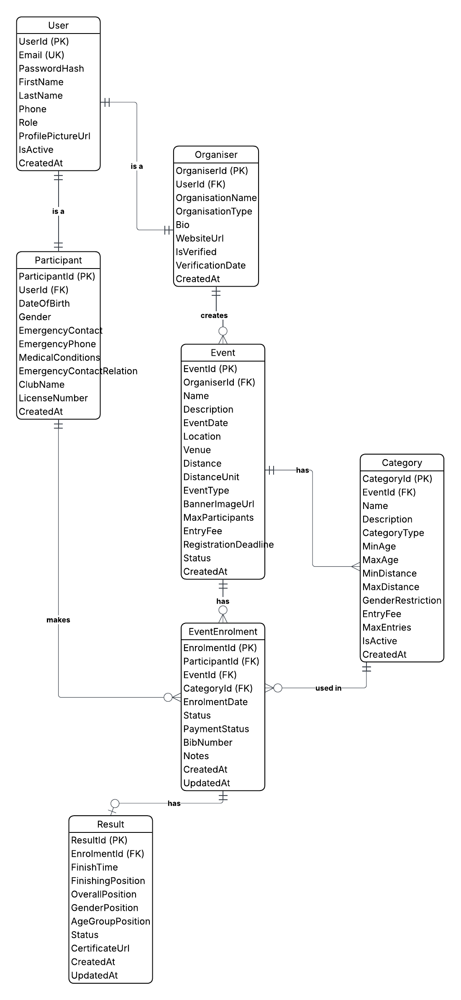
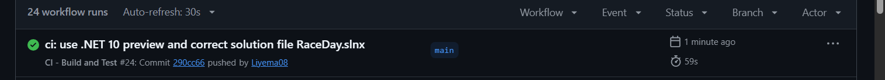

# 🏃 RaceDay - Event Management System
### PROG6212 - Programming 2B Portfolio of Evidence

[](https://github.com/Liyema08/PROG6212-POE-Part1/actions)

---

## 📋 Table of Contents
1. [Project Overview](#project-overview)
2. [User Roles](#user-roles)
3. [Database Design](#database-design)
4. [API Endpoint Plan](#api-endpoint-plan)
5. [Part 2 - RESTful API](#part-2---restful-api)
6. [Getting Started](#getting-started)
7. [CI/CD Pipeline](#cicd-pipeline)
8. [Video Presentation](#video-presentation)
9. [Student Information](#student-information)

---

## 🎯 Project Overview

**RaceDay** is a comprehensive event management platform designed specifically for the South African road running, walking, and cycling community.

### Key Features
- **Role-based access** for Organisers and Participants
- **Event management** with categories and enrolments
- **Results tracking** and performance history
- **Cloud-based image storage** (Azure Blob Storage - Part 3)
- **Containerised deployment** (Docker - Part 3)

---

## 👥 User Roles

### 🏢 Organiser
- Create, edit, and delete events
- Manage event categories (age/distance based)
- View all event enrolments
- Capture participant results (finish times and positions)

### 🏃 Participant
- Browse upcoming events with filtering
- Enrol in events by selecting a category
- View personal enrolment history
- Track personal race results

---

## 🗄️ Database Design

### Entity Relationship Diagram (ERD)



### Core Entities (7 Tables)

| # | Table | Description |
|---|-------|-------------|
| 1 | **User** | Base user information |
| 2 | **Organiser** | Extends User with organiser details |
| 3 | **Participant** | Extends User with participant details |
| 4 | **Event** | Core event information |
| 5 | **Category** | Event categories (age/distance based) |
| 6 | **EventEnrolment** | Links participants to events and categories |
| 7 | **Result** | Participant race results |

---

## 🔗 API Endpoint Plan

The API has **33 endpoints** organized as:

| Category | Count |
|----------|-------|
| Authentication | 4 |
| User Profile | 3 |
| Events | 6 |
| Categories | 4 |
| Enrolments | 5 |
| Results | 6 |
| **Total** | **28+** |

### Role Access Summary

| Role | Access |
|------|--------|
| **Public** | Register, Login |
| **Any (Logged in)** | Profile, View Events, View Categories |
| **Organiser Only** | Create/Update/Delete Events, Manage Categories, View Enrolments, Capture Results |
| **Participant Only** | Enrol in Events, View My Enrolments, View My Results |

---

## 🚀 Part 2 - RESTful API

### Overview
The RaceDay RESTful API is built with **ASP.NET Core 10 Web API** using **Entity Framework Core (Code-First)** and **SQL Server**.

### Technology Stack
| Technology | Purpose |
|-----------|---------|
| ASP.NET Core 10 | RESTful API framework |
| Entity Framework Core | ORM (Code-First) |
| SQL Server | Database |
| BCrypt.Net | Password hashing |
| NSwag | Swagger UI |
| xUnit | Unit testing |
| GitHub Actions | CI/CD |

### API Endpoints

#### Authentication (4)
- `POST /api/auth/register` - Register new user
- `POST /api/auth/login` - Login
- `POST /api/auth/logout` - Logout
- `GET /api/auth/me` - Get current user

#### User Profile (3)
- `GET /api/users/profile` - Get profile
- `PUT /api/users/profile` - Update profile
- `GET /api/users/{id}` - Get public profile

#### Events (6)
- `GET /api/events` - All events
- `GET /api/events/{id}` - Event details
- `POST /api/events` - Create (Organiser)
- `PUT /api/events/{id}` - Update (Organiser)
- `DELETE /api/events/{id}` - Delete (Organiser)
- `GET /api/events/organiser` - My events (Organiser)

#### Categories (4)
- `GET /api/events/{eventId}/categories`
- `POST /api/events/{eventId}/categories` (Organiser)
- `PUT /api/categories/{id}` (Organiser)
- `DELETE /api/categories/{id}` (Organiser)

#### Enrolments (5)
- `POST /api/events/{eventId}/enrol` (Participant)
- `GET /api/enrolments/me` (Participant)
- `GET /api/events/{eventId}/enrolments` (Organiser)
- `PUT /api/enrolments/{id}/status` (Organiser)
- `DELETE /api/enrolments/{id}` (Participant)

#### Results (6)
- `POST /api/events/{eventId}/results` (Organiser)
- `GET /api/events/{eventId}/results`
- `GET /api/results/me` (Participant)
- `GET /api/results/{id}`
- `PUT /api/results/{id}` (Organiser)
- `DELETE /api/results/{id}` (Organiser)

### Authentication
- Session-based authentication using `HttpContext.Session`
- Passwords hashed with BCrypt
- Role-based authorization enforced at controller level

### Part 2 Screenshots

#### Green Build


#### Swagger UI


---

## 🚀 Getting Started

### Prerequisites
- .NET 10 SDK
- SQL Server (LocalDB or full instance)
- Visual Studio Code or Visual Studio 2022
- Git

### Part 1 - Database Setup

1. Open SQL Server Management Studio
2. Run the script: `docs/RaceDay_Database.sql`
3. Verify database 'RaceDayDB' is created

### Part 2 - API Setup

```bash
# Clone the repository
git clone https://github.com/Liyema08/PROG6212-POE-Part1.git
cd PROG6212-POE-Part1

# Restore packages
dotnet restore RaceDay.slnx

# Apply migrations
cd RaceDay.API
dotnet ef database update

# Run the API
dotnet run